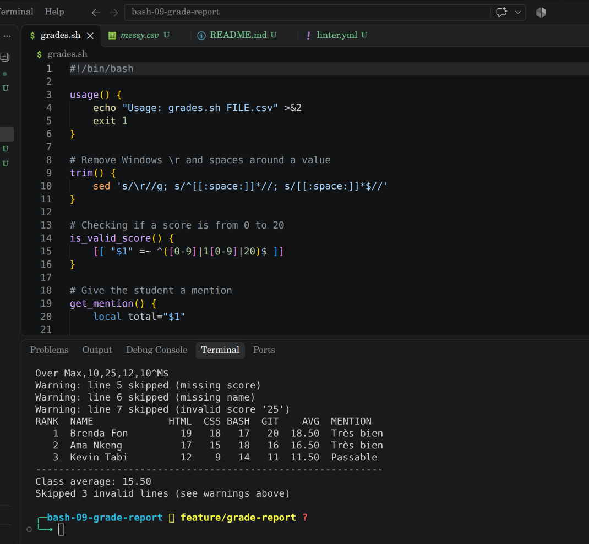

# Bash-09 Grade Report

## Problem Statement

Instructors spend a lot of time calculating student averages and rankings manually. This project makes the work easier by using a Bash script to read student scores from a CSV file and generate a grade report.

## Project Goal

The goal of this project is to create a simple Bash script that calculates student averages, assigns grade mentions, ranks students, and displays the class average.

## Tech Stack

- **Bash:** Used to write the main script.
- **AWK:** Used to calculate student averages.
- **Git and GitHub:** Used to manage and save project changes.
- **VS Code and Terminal:** Used to write, run, and test the script.

## Screenshots

This screenshot shows the output of the Grade Report script.



## Features

- Reads student scores from a CSV file.
- Calculates each student's average to two decimal places.
- Assigns grade mentions: Très bien, Bien, Assez bien, Passable, and Échec.
- Ranks students from the highest average to the lowest.
- Displays student information in organized columns.
- Skips invalid records and displays warning messages.
- Calculates and displays the class average.
- Shows the number of skipped records.
- Handles extra spaces and Windows line endings.

## Installation and Setup

**1. Clone the repository:**

```bash
git clone https://github.com/Fokeng126/bash-09-grade-report.git
```

**2. Enter the project folder:**

```bash
cd bash-09-grade-report
```

**3. Give the script permission to run:**

```bash
chmod +x grades.sh
```

**4. Run the script:**

```bash
./grades.sh grades.csv
```

## Challenges Faced

- **File naming:** I initially used the wrong filenames and had to correct them to match the project requirements.
- **Decimal calculations:** Bash does not directly support decimal arithmetic, so I used AWK to calculate student averages.
- **Input validation:** I learnt how to check student records and skip invalid data without stopping the entire script.
- **Project setup:** I created the project folders and files manually using terminal commands.

## What I Learnt

- How to read CSV files line by line using Bash.
- How to use functions in Bash scripts.
- How to use AWK for calculations.
- How to validate input and handle errors.
- How to sort student records and calculate rankings.
- How to use Git branches, commits, and pull requests.
- How to write and test a Bash project.

## Author

**Joshua Kroos**
